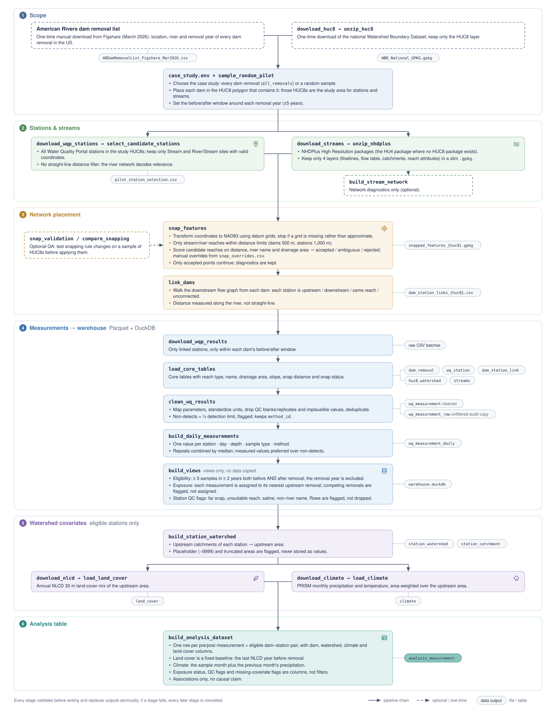

# Dam Removal and Water Quality

DS5500 capstone project (Northeastern, team 4) studying how dam removals affect water quality upstream and downstream of the removed dam.

The pipeline links each dam removal to the water-quality monitoring stations on the same river network, downloads those stations' measurements from the years around the removal, and loads everything into a small Parquet + DuckDB warehouse for analysis.

## Data sources

| Source | Used for |
|---|---|
| American Rivers dam removal list (Figshare, Mar 2026) | Dam locations and removal years (placed manually in `data/raw/dams/`) |
| USGS Watershed Boundary Dataset (WBD), national GeoPackage | HUC8 watershed boundaries |
| NHDPlus High Resolution | Stream flowlines and the flow network |
| Water Quality Portal (WQP) | Monitoring stations and measurements |
| Annual NLCD, Collection 1.2 (MRLC; 30 m, 1985–2025) | Land cover of each station's upstream area |
| PRISM AN monthly grids (PRISM Climate Group; 800 m) | Precipitation and mean temperature over each station's upstream area |



The flowchart is drawn by `docs/pipeline_flowchart.py` (writes the SVG and a PNG for reports); edit the content there and re-run it.

## Repository layout

```
config/          Case-study configs (which HUC8s and dams are in scope),
                 snap_overrides.csv (reviewed manual snapping decisions) and
                 known_station_reaches.csv (stations with a known wrong reach)
etl/             Pipeline scripts (one per stage) and shared helpers in etl/common/
analysis/        Helpers for the preprocessing audit notebook (audit_utils.py)
data/slurm/      One Slurm job per pipeline stage; case_study.env selects the config
docs/            Warehouse spec (warehouse_spec.md), re-run runbook
                 (rerun_after_snapping.md), pipeline flowchart
notebooks/       Exploration, QA and audit notebooks
tests/           Lightweight tests, runnable with `python tests/<file>.py` or pytest
```

Generated configs (`pilot_random<n>_seed<seed>.yaml`, `all_removals.yaml`) are created on the cluster by `sample_random_pilot` and may not be in your local checkout.

Data (`data/raw/`, `data/processed/`, `data/warehouse/`) is not tracked in git. WQP station selections and result downloads are stored per case study under `data/raw/wqp/results/<case_study>/`. It lives on the Explorer cluster at `/courses/DS5500.202710/teams/team4`.

## Setup

On Explorer:

```bash
sbatch create_env.slurm        # creates or updates the `dam-removal` conda env
```

Choose the case study in `data/slurm/case_study.env`, the one file every job reads. For a random sample of dams, set `PILOT_N_DAMS` and `PILOT_SEED`; `run_pipeline.sh` generates `config/pilot_random<N>_seed<SEED>.yaml` on its first run.

Run the tests after pulling changes (results in `data/slurm/logs/`):

```bash
sbatch data/slurm/run_tests.slurm
```

## Pipeline

To run stages 3–18 as one chain of Slurm jobs (each waits for the previous one to succeed), run from the login node:

```bash
bash data/slurm/run_pipeline.sh                      # every stage
bash data/slurm/run_pipeline.sh --from snap_features # resume from a stage
bash data/slurm/run_pipeline.sh --to select_candidate_stations   # stop after a stage
```

The case study is set in `data/slurm/case_study.env`: `PILOT_N_DAMS=all` runs every dam removal (`all_removals`); a number runs a random sample (`pilot_random<n>_seed<seed>`).

**8-hour job limit.** Stages that resume where they stopped (downloads, unzipping, and the per-HUC8 snap/link stages) are submitted as several attempts; each extra attempt picks up after a time-out and finishes in minutes if there's nothing left (`--list` shows the counts). HUC8s with no NHDPlus HR coverage are skipped with a warning and left out of later stages. If a stage fails, every later job in the chain is cancelled.

**Re-runs overwrite, downloads are reused.** Submitting a stage clears its progress markers, so it recomputes every HUC8 and replaces its outputs in place (snapped features, links, warehouse tables), with no automatic backup; back up first (see the runbook below). The download stages are the exception: `download_wqp_results`, `download_nlcd` and `download_climate` fetch only what isn't already on disk.

**Don't hold `warehouse.duckdb` open while the chain runs.** Several stages (`build_views`, `build_station_watershed`, the land-cover and climate loads) write to it, and DuckDB refuses the write if another process, such as a notebook, has the file open, even read-only. In notebooks, read the Parquet files directly or open the database only inside a `with` block.

**Storage.** Intermediate data is deleted once used: NHDPlus zips after unzipping, all but the NHDPlus layers the pipeline reads (`unzip_nhdplus` keeps a slim GeoPackage per package: 4 core layers plus NHDArea, NHDWaterbody and NHDPlusBurnWaterbody), all WBD layers but HUC8 (`slim_wbd.py`, run by `unzip_huc8`), and the NLCD/PRISM clips after `load_land_cover`/`load_climate` (`--keep-clips` keeps them). NLCD/PRISM clips cover only the catchments the stations need.

The stages, in order:

1. `download_huc8` → `unzip_huc8`: WBD boundaries
2. `sample_random_pilot` (optional): generate a config from a random sample of dams
3. `download_wqp_stations` → `select_candidate_stations`: WQP stations in the case-study HUC8s
4. `download_streams` → `unzip_nhdplus`: NHDPlus HR packages, kept as slim GeoPackages (4 core + 3 water layers; packages slimmed earlier are re-downloaded and only the missing layers added; `HU4="..."` limits the run)
5. `build_stream_network`: network diagnostics (not in the chain; run separately if needed)
6. `snap_features`: match dams and stations to an NHDPlus reach (datum transformation, stream types only, distance limits, name and drainage-area checks, manual overrides in `config/snap_overrides.csv`); each point is accepted, ambiguous or rejected, and only accepted ones go on (spec 3.12)
7. `link_dams`: classify each station as upstream, downstream or unconnected relative to each dam
8. `download_wqp_results`: measurements within each dam's analysis window (re-runs download only station windows not already downloaded)
9. `load_core_tables`: write the core warehouse tables (see below)
10. `clean_wq_results`: clean the downloaded results into `wq_measurement`
11. `build_daily_measurements`: one value per station, day, depth, sample type and method (`wq_measurement_daily`)
12. `build_views`: `warehouse.duckdb` views, including which dams have enough before/after data, each measurement's nearest upstream removal, and station quality flags
13. `build_station_watershed`: upstream drainage area of each eligible station (context data, step 1 of 3), with placeholder and truncation flags
14. `download_nlcd`: Annual NLCD land cover for the needed years, clipped per NHDPlus package
15. `load_land_cover`: land-cover percentages per station and year
16. `download_climate`: monthly PRISM precipitation and temperature for the needed years, clipped per NHDPlus package
17. `load_climate`: monthly climate per station, area-weighted over its upstream area
18. `build_analysis_dataset`: the modeling table `analysis_measurement`, one row per pre/post measurement of each eligible dam-station pair with dam, watershed, climate and baseline land-cover columns, exposure status and quality flags (design choices in the spec, 3.11)

Stages 14–17 keep existing rows for stations whose upstream area hasn't changed and compute only new or changed ones.

**Snapping changes.** Validate before re-running; these jobs write to `data/processed/snap_validation/` and leave current outputs untouched:

```bash
sbatch data/slurm/snap_validation.slurm   # known-failure HUC8s + a random sample, then etl/compare_snapping.py
sbatch data/slurm/snap_recheck.slurm      # re-snap a few HUC8s after a rule change and re-compare
```

The full procedure (validate, back up, `run_pipeline.sh --from snap_features`, what to check in each log) is in [`docs/rerun_after_snapping.md`](docs/rerun_after_snapping.md).

**Reach-matching rework (in progress).** A replacement for `snap_features` that picks each point's flowline from hydrologic evidence (the water polygon or catchment it is in, drainage area, name, then distance) and only then projects the reported point onto it (spec 3.13). It runs alongside the pipeline, writing to its own folders; nothing the pipeline reads changes until it is wired into linking:

```bash
sbatch data/slurm/nhdplus_diagnostics.slurm                 # 1: stored NHDPlus relationships, per package
HU4="..." sbatch data/slurm/station_candidates.slurm        # 2: candidate reaches and evidence per station
FILL_WRONG_REACHES=1 sbatch data/slurm/select_station_reaches.slurm   # once: record the known wrong reaches
HU4="..." sbatch data/slurm/select_station_reaches.slurm    # 3: choose station reaches, check known stations
HU4="..." sbatch data/slurm/match_dams.slurm                # 4: dams: reservoir outlet, structure and downstream flowlines
```

**Checking a run.** `notebooks/warehouse_qa.ipynb` checks the core and cleaned tables (row counts, key integrity, maps). `notebooks/preprocessing_audit.ipynb` audits `analysis_measurement` for duplicates, misplaced stations, outliers and competing removals; it needs the full chain to have finished, about 32 GB of memory, and it writes its flag tables to `data/processed/preprocessing_audit/<case_study>/`. `notebooks/warehouse_integrity.ipynb` checks that no derived table is stale (from an earlier snapping or linking run), that no sample is future-dated, what the link distance limits keep, and raw-to-cleaned retention before vs after removal. `notebooks/analysis_robustness.ipynb` estimates the before/after change with one exposure per measurement, dam-level averages, a matched upstream control, measurement-consistency checks and a by-dam event study. Set `CASE_STUDY` at the top of each notebook.

## Warehouse

Curated tables are written as Parquet (GeoParquet for geometry) to `data/warehouse/<case_study>/` and queried with DuckDB. The column-level spec, cleaning rules and validation checks are in [`docs/warehouse_spec.md`](docs/warehouse_spec.md), based on the ERD in `DS5500 Capstone ERD final.jpeg`.

| Table | Status |
|---|---|
| `dam_removal`, `wq_station`, `dam_station_link`, `huc8_watershed`, `streams` | `load_core_tables.py` |
| `wq_measurement`, `wq_measurement_raw` | `clean_wq_results.py` (rules in `etl/common/wq_rules.py`) |
| `wq_measurement_daily` | `build_daily_measurements.py` |
| `station_watershed` | `build_station_watershed.py` |
| `station_catchment` | `build_station_watershed.py` |
| `land_cover`, `land_cover_codes` | `load_land_cover.py` |
| `climate` | `load_climate.py` |
| `analysis_measurement` | `build_analysis_dataset.py` |

`build_views.py` writes `data/warehouse/<case_study>/warehouse.duckdb`, which holds views only (no data). Open it with `duckdb.connect(path, read_only=True)` and query e.g. `eligibility_summary`. Eligibility thresholds come from the config's optional `eligibility: {min_samples: 3, min_years: 2}` block; the saline threshold from `qc: {saline_sc_us_cm: 3000}`, the exposure distance ratio from `exposure: {min_distance_ratio: 2}`, the link distance limits from `exposure: {max_downstream_km: 10, max_upstream_km: 10}` (default: no limit; `dam_station_link` keeps every link), and snapping limits from `snapping: {dams: {...}, stations: {...}}`.

## Current status

Case study: `all_removals` (every dam removal in the list). The smaller pilots (`pilot_random5_seed42`, and `pilot_random50_seed7` kept as a benchmark) were used to develop the pipeline.

As of 2026-10-25: after the preprocessing audit, the pipeline gained scored snapping, the daily measurement table, exposure assignment and station QC flags (see the runbook). The full `all_removals` chain is being re-run with these changes. Next: re-run `warehouse_qa` and `preprocessing_audit` on the new outputs and compare with the pre-change audit. `report_pilot_eligibility` is kept only until the `build_views` eligibility views have been checked against it.

As of 2026-10-30: the reach-matching rework (spec 3.13) has stages 1–4 implemented and tested on synthetic data; the water layers have been added for HU4s 0104, 0108, 0205, 0301, 0701, 0707, 1019, 1709 and 1902, where stages 2–4 are being validated. Next: stage 5, re-linking dams and stations from the new matches and comparing with the current links.
